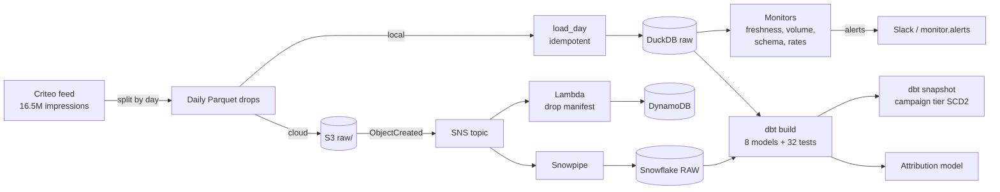

# Marketing data platform

A daily marketing data pipeline on real ad-serving data: Criteo's public attribution feed (16.5M ad impressions over 31 days). It lands one drop per day, loads it idempotently, and monitors every load for freshness, volume, schema and rate changes. It then builds a tested dbt star schema with an SCD type 2 snapshot and feeds an attribution model, all orchestrated with Prefect. Terraform defines the cloud version: S3, SNS fan-out, a Lambda and Snowpipe into Snowflake.



Everything runs locally on DuckDB. The same dbt project also has a Snowflake target, and the Terraform describes the cloud deployment. See **Limits** for what has and hasn't been run.

## Data

The **Criteo Attribution Modeling for Bidding Dataset** (Criteo AI Lab, CC BY-NC-SA 4.0), from Criteo's [Hugging Face repository](https://huggingface.co/datasets/criteo/criteo-attribution-dataset). It's a sample of 30 days of live traffic: one row per impression, with clicks, conversions, a transformed cost, and whether the advertiser credited the conversion to Criteo.

- **Fetch:** `scripts/fetch_data.sh` downloads the file.
- **Checksum:** the downloaded file's SHA-256 matches the repository's LFS hash (`94ac7a46…`).
- **CI sample:** `tests/data/criteo_sample.tsv.gz` holds every impression of 1,275 users (3,299 rows, 80 conversions), so CI runs the real pipeline without the full file.

What profiling the full file found, before any modelling:

| | |
|---|---|
| Impressions | 16,468,027 (436,408 to 638,165 per day, days 0 to 30) |
| Users / campaigns | 6,142,256 / 675 |
| Conversions (distinct `conversion_id`) | 435,810, of which 236,331 (54.2%) credited to Criteo. The README's "45K" doesn't match the file. |
| Conversions with no click | 0 (every conversion path contains a click) |
| Conversions spanning more than one campaign or user | 2,910. Kept, and reported by a warn-level test on every run |
| Conversion timestamps | up to day 60 (30 days after the last impression) |

## Pipeline

| Step | Code | What it does |
|---|---|---|
| Land | `mdp/ingest.py` | Splits the feed into one Parquet drop per day. When `MDP_S3_BUCKET` is set, uploads to `s3://…/raw/impressions/day=NN/`. |
| Load | `mdp/ingest.py` | Loads one day into `raw.impressions` with the source file, row number and load time. Re-loading a day replaces it, so it's idempotent. |
| Monitor | `mdp/monitors.py` | Records daily metrics, then checks schema drift against the contract, null cells, row volume (outside half to double the trailing 7-day median), click and conversion rates (robust z > 4 **and** at least a 10% move) and freshness (26 hours). Writes `monitor.alerts` and posts to Slack when `SLACK_WEBHOOK_URL` is set. |
| Transform | `transform/` (dbt) | `stg_impressions` → `int_conversion_journeys`, `int_campaign_tier` → marts `fct_impressions` (incremental, delete+insert by day), `fct_conversions`, `fct_campaign_daily`, `dim_campaign`, `dim_date`. |
| Test | `transform/models/**.yml`, `transform/tests/` | 32 data tests: unique, not-null, accepted values, relationships from facts to dimensions, a unique campaign × day grain, non-negative cost, conversion after first touch, credited conversions have a click, campaign-day spend reconciles to the impression fact, and the warn-level multi-campaign check. Source freshness runs separately (`dbt source freshness`). |
| Snapshot | `transform/snapshots/` | SCD type 2 history of each campaign's spend tier (high/mid/low tercile of spend to date), captured after every daily load. |
| Orchestrate | `mdp/flows.py` | Prefect `daily-marketing-pipeline` (land → load → monitor → dbt build → snapshot, with retries) and `backfill`, which replays the days in order. |
| Use | `mdp/attribution.py` | Predicts which conversions the advertiser credits to Criteo. |

## Results (full feed, one backfill run)

All numbers are in `results/pipeline_summary.json` and `results/attribution.json`.

**Pipeline**
- **Run:** the backfill replayed **31 daily runs in 463 seconds** on a laptop under WSL, each loading a day, monitoring it, rebuilding incrementally, running the tests and snapshotting.
- **Tests:** every run built all 8 models and passed **31 of 32** data tests; the 32nd is the warn-level check on the 2,910 multi-campaign or multi-user conversions. No errors.
- **Reconciliation:** `fct_impressions` holds 16,468,027 rows (matches raw) and `fct_conversions` holds 435,810. Campaign-day spend reconciles to the impression fact.
- **Snapshot:** 1,057 tier versions; **204 of 675 campaigns changed spend tier** at least once.
- **Monitors:**
  - **First version was too noisy:** it alerted 8 times on clean data, flagging click and conversion-rate moves of 5 to 9% because the trailing spread is tiny.
  - **The fix:** an alert now also needs a move of at least 10%. Replayed over the 31 days, it raises **0 alerts on clean data**.
  - **It still catches real problems:** the tests show it flags a simulated 90% volume drop and a schema change (a dropped and an added column).
- **Spend concentration:** the top 10 campaigns account for 25.8% of spend, and every campaign has at least one credited conversion.

**Attribution: which conversions does the advertiser credit to Criteo?**

Out-of-time evaluation: trained on conversions from days 0 to 24 (274,709), tested on days 25 to 60 (158,191). Campaign error is the median absolute % error in credited conversions per campaign (355 campaigns with at least 50 test conversions).

| Model | AUC | Accuracy | Campaign error |
|---|---|---|---|
| Rule: credited if last click ≤ 4.0 h before conversion (threshold fitted on train) | 0.729 | 71.9% | 58.3% |
| Logistic regression on path features | 0.733 | 71.9% | 28.8% |
| Gradient boosting + campaign credit rate | **0.801** | **74.6%** | **24.5%** |

- **Gain over the rule:** gradient boosting improves AUC by **+0.072**, with a paired-bootstrap 95% CI of +0.070 to +0.074.
- **The credited share drifts:** it falls from **60.8%** in training to **42.3%** in testing. Every model under-counts total credited conversions in the test period (gradient boosting predicts 51.5k against 63.9k actual), so totals would need recalibrating on recent data before being used for budgets.

## Cloud deployment (Terraform, `infra/`)

- **S3:** the landing bucket is private, versioned and encrypted. Drops move to infrequent access after 30 days, and old versions expire.
- **Event-driven fan-out:** an S3 `ObjectCreated` event goes to an **SNS topic**. Snowflake subscribes its Snowpipe queue to that topic, and a **Lambda** writes each drop's key, size and arrival time to a **DynamoDB** manifest. The Lambda also alerts on empty drops.
- **Snowflake:** an AWS storage integration plus an IAM role it assumes (external-ID condition); database, layer schemas, an XS warehouse with 60-second auto-suspend, an external stage, the raw table, and **Snowpipe auto-ingest**. The pipe's `COPY` records the file name and row number, the same lineage columns the local loader writes.
- **Access:** a least-privilege `TRANSFORMER` role, granted to the dbt/Prefect user.
- **Secrets:** credentials come from the environment (key-pair auth for Snowflake), never from the repo.

## Run it

```bash
pip install -e ".[dev]"            # add [snowflake] for the Snowflake target
scripts/fetch_data.sh data/raw      # 653 MB; or use tests/data/criteo_sample.tsv.gz
export MDP_LANDING=data/landing MDP_WAREHOUSE=warehouse.duckdb
python -m mdp prepare data/raw/criteo_attribution_dataset.tsv.gz
python -m mdp backfill             # 31 daily Prefect runs
python -m mdp attribution
python -m mdp.summary
```

Docker runs the whole pipeline on the bundled sample: `docker build -t mdp . && docker run --rm mdp`.

The CI workflow (GitHub Actions) runs these jobs:
- **python:** `ruff` and 8 pytest tests.
- **pipeline:** the full Prefect + dbt pipeline on the sample, plus `dbt source freshness`.
- **terraform:** `terraform fmt -check` and `validate`.
- **docker:** builds the image.

## Limits

- **The cloud path is defined but not deployed.** The Terraform passes `terraform validate` (AWS provider 5.x, Snowflake provider 2.x, no deprecation warnings), but it has not been applied: that needs an AWS account and a Snowflake account. The dbt Snowflake target is configured but has not been run against Snowflake.
- **Costs and timestamps are anonymised.** Costs are Criteo's transformed values, not real prices. Timestamps are relative, so days are numbered 0 to 60 and no calendar dates are invented.
- **The tier snapshot is derived.** Spend tiers come from the data (tercile of spend to date), not from a real campaign-management system.
- **Rerun timings will vary.** The 463-second backfill is one run on one machine.

Citation: Diemert, Meynet, Galland, Lefortier. *Attribution Modeling Increases Efficiency of Bidding in Display Advertising.* AdKDD & TargetAd Workshop, KDD 2017.
